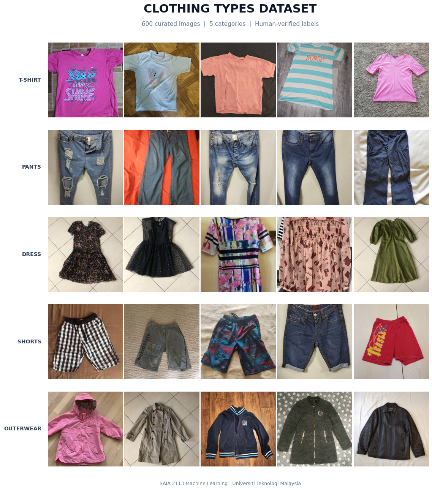
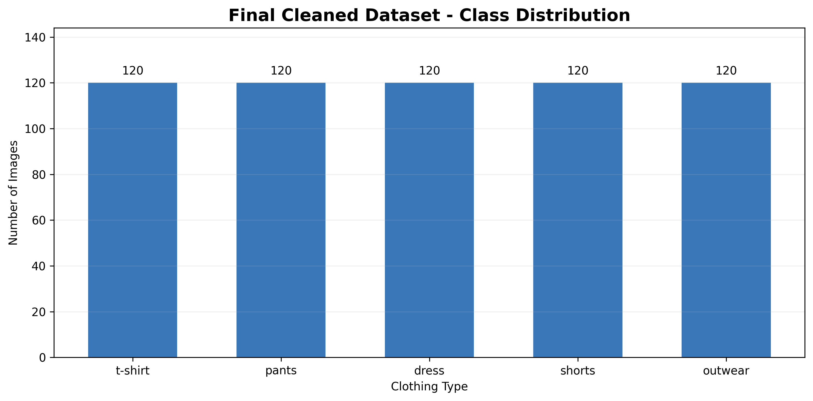

# Clothing Types Classification

**An End-to-End Machine Learning Pipeline for Clothing Image Classification**

`Machine Learning` · `Computer Vision` · `Clustering` · `Explainable AI`

---


## Overview

Clothing Types Classification is a machine learning project developed for SAIA 2113 — Machine Learning at Universiti Teknologi Malaysia (UTM).

The project explores the classification of clothing images through a structured pipeline involving dataset collection, quality assessment, supervised learning, unsupervised clustering, and model explainability.

The project prioritizes data quality, reproducibility, reliable evaluation, and meaningful interpretation of machine learning predictions.

## Project Information

| Information | Details |
|---|---|
| University | Universiti Teknologi Malaysia |
| Faculty | Faculty of Artificial Intelligence |
| Course | SAIA 2113 — Machine Learning |
| Academic Session | Semester 1, 2026/2027 |
| Project Type | Multiclass Image Classification |
| Development Environment | Google Colab |
| Programming Language | Python |
| Project Status | In Development |

## Project Objectives

- Develop a curated and balanced clothing image dataset.
- Implement a reproducible image preprocessing pipeline.
- Develop and evaluate a supervised classification model.
- Explore clothing image similarities using K-Means clustering.
- Interpret model predictions using Explainable AI.
- Compare supervised and unsupervised learning approaches.

## Dataset

The project uses the Clothing Dataset (Small) by Alexey Grigorev as its primary data source.

- **Source:** [Clothing Dataset — GitHub](https://github.com/alexeygrigorev/clothing-dataset-small)
- **Dataset licence:** CC0-1.0
- **Original source:** 3,781 images across 10 categories
- **Selected raw images:** 2,278 images
- **Final curated dataset:** 600 images
- **Selected classes:** 5

### Class Distribution

| Clothing Class | Raw Images | Final Images |
|---|---:|---:|
| T-Shirt | 928 | 120 |
| Pants | 559 | 120 |
| Dress | 288 | 120 |
| Shorts | 257 | 120 |
| Outerwear | 246 | 120 |
| **Total** | **2,278** | **600** |

The final dataset contains an equal number of images per class. The original folder label `outwear` is retained for implementation consistency.

### Dataset Preview



*Representative samples from the five curated clothing categories.*

### Class Distribution Visualization



*Balanced dataset containing 120 verified images per class.*


### Dataset Quality Assurance

The dataset was curated through a combination of automated technical checks and human visual verification.

The cleaning workflow includes:

- Image integrity and readability verification
- Image resolution assessment
- Exact duplicate detection using SHA-256
- Potential near-duplicate detection using perceptual hashing
- Manual duplicate verification
- Clothing class criteria definition
- Interactive visual label verification
- CLIP-assisted candidate screening
- Human-approved final image selection
- Dataset manifest and file integrity validation

CLIP was used to assist candidate screening rather than automatically assign ground-truth labels.

### Cleaning Outcomes

| Assessment | Result |
|---|---:|
| Raw images assessed | 2,278 |
| Unreadable images detected | 0 |
| Low-resolution images detected | 0 |
| Exact duplicate pairs detected | 0 |
| Potential near-duplicate pairs | 4 |
| Confirmed duplicates among reviewed pairs | 0 |
| Human-approved images | 602 |
| Final selected images | 600 |
| Final validation checks passed | 8/8 |

Pending, rejected, and uncertain images are excluded from the final dataset.

## Machine Learning Pipeline

The project follows six main implementation phases.

**01 — Data Collection and Cleaning**

Dataset acquisition, technical quality assessment, visual label verification, and final dataset selection.

**02 — Data Preprocessing**

Image resizing, normalization, label encoding, stratified dataset splitting, and training-only data augmentation.

**03 — Supervised Learning**

Image classification using a proposed transfer learning approach with MobileNetV2, including hyperparameter tuning and model evaluation.

**04 — Unsupervised Learning**

Independent feature extraction, K-Means clustering, optimal cluster selection, and comparison against ground-truth labels.

**05 — Explainable AI**

Grad-CAM visualization and interpretation of meaningful image regions influencing model predictions.

**06 — Comparative Analysis**

Comparison of supervised and unsupervised learning results, limitations, and potential improvements.


## Implementation Notebooks

| Phase | Notebook | Status |
|---|---|---|
| 01 | Data Collection and Cleaning | Completed |
| 02 | Data Preprocessing | Planned |
| 03 | Supervised Learning | Planned |
| 04 | Unsupervised Learning | Planned |
| 05 | Explainable AI | Planned |
| 06 | Comparative Analysis | Planned |

### Phase 01 — Data Collection and Cleaning

[](https://colab.research.google.com/github/ShamsirIsmail/Clothing-Types-Machine-Learning-Assignment/blob/main/notebooks/01_data_collection.ipynb)


## Technology Stack

| Technology | Purpose |
|---|---|
| Python | Core programming language |
| Google Colab | Development and experimentation |
| Google Drive | Dataset and experiment storage |
| GitHub | Version control and collaboration |
| NumPy | Numerical operations |
| Pandas | Dataset management and analysis |
| Pillow | Image processing |
| ImageHash | Perceptual duplicate detection |
| Matplotlib | Data visualization |
| ipywidgets | Interactive dataset verification |
| PyTorch | CLIP inference |
| Hugging Face Transformers | Pretrained CLIP model |
| TensorFlow / Keras | Planned supervised learning implementation |
| scikit-learn | Planned preprocessing, clustering and evaluation |

## Planned Evaluation Metrics

### Supervised Learning

- Accuracy
- Macro Precision
- Macro Recall
- Macro F1-Score
- Confusion Matrix
- Training and Validation Curves

### Unsupervised Learning

- Elbow Method
- Silhouette Score
- Adjusted Rand Index
- Normalized Mutual Information
- Cluster Contingency Table

### Explainable AI

- Grad-CAM Heatmaps
- Correct Classification Analysis
- Misclassification Analysis
- Visual Feature Interpretation

## Project Structure

The following structure will be developed throughout the project.

```text
Clothing-Types-Machine-Learning-Assignment/
├── notebooks/
│   ├── 01_data_collection.ipynb
│   ├── 02_data_preprocessing.ipynb
│   ├── 03_supervised_learning.ipynb
│   ├── 04_unsupervised_learning.ipynb
│   ├── 05_explainable_ai.ipynb
│   └── 06_comparative_analysis.ipynb
├── scripts/
├── reports/
├── assets/
├── documentation/
├── requirements.txt
├── .gitignore
└── README.md
```

Raw datasets and large experiment artifacts are maintained separately from the source code repository.

## Project Progress

- [x] Project setup
- [x] Dataset acquisition
- [x] Clothing class selection
- [x] Automated data quality assessment
- [x] Duplicate verification
- [x] Human visual label verification
- [x] Final dataset selection
- [x] Dataset validation and export
- [x] Phase 1 reproducibility documentation
- [ ] GitHub integration
- [ ] Data preprocessing
- [ ] Supervised model training
- [ ] Hyperparameter tuning
- [ ] K-Means clustering
- [ ] Explainable AI implementation
- [ ] Comparative analysis
- [ ] Final documentation

## Reproducibility

The project maintains reproducibility through:

- Fixed random seed of 42
- Recorded dataset source version and Git commit
- Documented image selection criteria
- SHA-256 image integrity records
- Persistent human review decisions
- Dataset manifests
- Recorded Python library versions
- Separate raw and cleaned datasets

The finalized dataset and its accompanying documentation are preserved as a ZIP archive for subsequent machine learning experiments.

## Academic Integrity

This repository is maintained for academic and educational purposes.

AI-assisted coding and dataset screening are documented transparently. Final dataset inclusion decisions are based on human verification.

The use of AI tools is subject to the course's academic integrity requirements.

## Acknowledgements

- Universiti Teknologi Malaysia — Faculty of Artificial Intelligence
- SAIA 2113 Machine Learning
- Alexey Grigorev — Clothing Dataset
- Open-source Python and machine learning communities

---

**Clothing Types Classification**

Universiti Teknologi Malaysia · Machine Learning · 2026/2027
