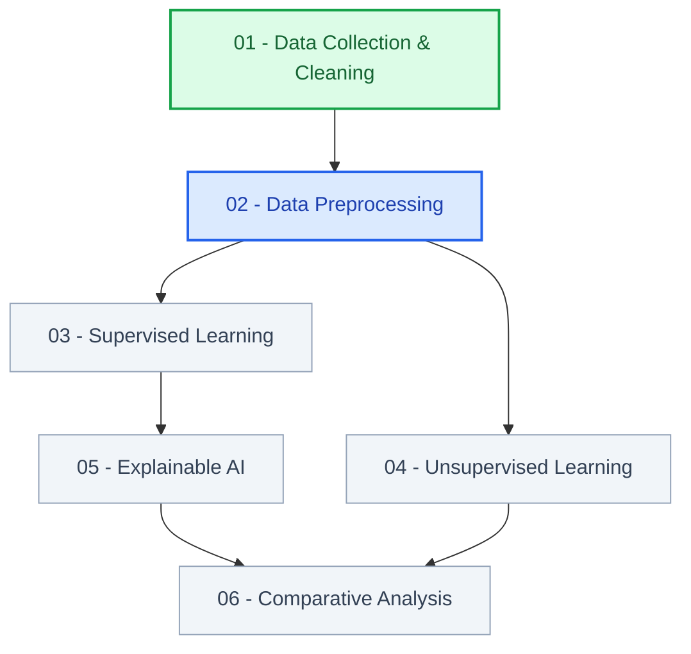

# Clothing Types Classification

**An End-to-End Machine Learning Pipeline for Clothing Image Classification**

`Machine Learning` · `Computer Vision` · `Clustering` · `Explainable AI`

---


## Overview

Clothing Types Classification is a machine learning project developed for SAIA 2113 — Machine Learning at Universiti Teknologi Malaysia (UTM).

The project explores the classification of clothing images through a structured pipeline involving dataset collection, quality assessment, supervised learning, unsupervised clustering, and model explainability.

The project prioritizes data quality, reproducibility, reliable evaluation, and meaningful interpretation of machine learning predictions.

## Project Information

| Information | Details |
|---|---|
| University | Universiti Teknologi Malaysia |
| Faculty | Faculty of Artificial Intelligence |
| Course | SAIA 2113 — Machine Learning |
| Academic Session | Semester 1, 2026/2027 |
| Project Type | Multiclass Image Classification |
| Development Environment | Google Colab |
| Programming Language | Python |
| Project Status | In Development |

## Project Objectives

- Develop a curated and balanced clothing image dataset.
- Implement a reproducible image preprocessing pipeline.
- Develop and evaluate a supervised classification model.
- Explore clothing image similarities using K-Means clustering.
- Interpret model predictions using Explainable AI.
- Compare supervised and unsupervised learning approaches.

## Dataset

The project uses the Clothing Dataset (Small) by Alexey Grigorev as its primary data source.

- **Source:** [Clothing Dataset — GitHub](https://github.com/alexeygrigorev/clothing-dataset-small)
- **Dataset licence:** CC0-1.0
- **Original source:** 3,781 images across 10 categories
- **Selected raw images:** 2,278 images
- **Final curated dataset:** 600 images
- **Selected classes:** 5

### Class Distribution

| Clothing Class | Raw Images | Final Images |
|---|---:|---:|
| T-Shirt | 928 | 120 |
| Pants | 559 | 120 |
| Dress | 288 | 120 |
| Shorts | 257 | 120 |
| Outerwear | 246 | 120 |
| **Total** | **2,278** | **600** |

The final dataset contains an equal number of images per class. The original folder label `outwear` is retained for implementation consistency.


<h3>Dataset Preview</h3>

<p align="center">
  
</p>

<p align="center">
  <sub>600 curated images · 5 clothing categories · 120 images per class</sub>
</p>


### Dataset Quality Assurance

The dataset was curated through a combination of automated technical checks and human visual verification.

The cleaning workflow includes:

- Image integrity and readability verification
- Image resolution assessment
- Exact duplicate detection using SHA-256
- Potential near-duplicate detection using perceptual hashing
- Manual duplicate verification
- Clothing class criteria definition
- Interactive visual label verification
- CLIP-assisted candidate screening
- Human-approved final image selection
- Dataset manifest and file integrity validation

CLIP was used to assist candidate screening rather than automatically assign ground-truth labels.

### Cleaning Outcomes

| Assessment | Result |
|---|---:|
| Raw images assessed | 2,278 |
| Unreadable images detected | 0 |
| Low-resolution images detected | 0 |
| Exact duplicate pairs detected | 0 |
| Potential near-duplicate pairs | 4 |
| Confirmed duplicates among reviewed pairs | 0 |
| Human-approved images | 602 |
| Final selected images | 600 |
| Final validation checks passed | 8/8 |

Pending, rejected, and uncertain images are excluded from the final dataset.


## Machine Learning Pipeline

The project follows a structured machine learning workflow, integrating data quality assurance, supervised classification, unsupervised clustering, and model explainability.



**Status:** Completed (Green) · Next Phase (Blue) · Planned (Grey)

### Implementation Details

<details>
<summary><b>01 — Data Collection & Cleaning</b> · Completed</summary>

<br>

**Objective**

Build a balanced and carefully curated clothing image dataset with consistent class labels.

**Implementation**

- Dataset acquisition and class selection
- Image integrity and resolution assessment
- SHA-256 exact duplicate detection
- Perceptual hash similarity analysis
- Interactive human label verification
- CLIP-assisted candidate screening
- Final dataset validation and export

**Results**

| Metric | Result |
|---|---:|
| Raw images | 2,278 |
| Final images | 600 |
| Clothing categories | 5 |
| Images per class | 120 |
| Validation checks | 8/8 passed |

**Technologies:** Pandas, Pillow, ImageHash, PyTorch, Transformers, ipywidgets.

[](https://colab.research.google.com/github/ShamsirIsmail/Clothing-Types-Machine-Learning-Assignment/blob/main/notebooks/01_data_collection.ipynb)

</details>

<details>
<summary><b>02 — Data Preprocessing</b> · Next Phase</summary>

<br>

**Objective**

Prepare the cleaned dataset for reliable machine learning experiments.

**Planned Implementation**

- Image resizing and aspect ratio preservation
- RGB image conversion
- Pixel normalization
- Numerical label encoding
- Stratified train, validation, and test splitting
- Training-only data augmentation
- Data leakage prevention

**Expected Outputs**

- Reproducible dataset splits
- Class mapping
- Preprocessing configuration
- Dataset distribution visualizations

**Technologies:** NumPy, Pillow, TensorFlow, scikit-learn.

</details>

<details>
<summary><b>03 — Supervised Learning</b> · Planned</summary>

<br>

**Objective**

Develop and evaluate a multiclass clothing classification model.

**Planned Implementation**

- MobileNetV2 transfer learning
- Classification head development
- Hyperparameter tuning
- Model training and validation
- Independent test set evaluation

**Evaluation Metrics**

- Accuracy
- Macro Precision
- Macro Recall
- Macro F1-Score
- Confusion Matrix

**Expected Outputs**

Trained classification model, learning curves, classification report, and confusion matrix.

</details>

<details>
<summary><b>04 — Unsupervised Learning</b> · Planned</summary>

<br>

**Objective**

Investigate whether clothing images can be grouped into meaningful clusters without using class labels during clustering.

**Planned Implementation**

- Independent image feature extraction
- Feature scaling
- Dimensionality reduction using PCA
- K-Means clustering
- Optimal cluster selection
- Cluster interpretation

**Evaluation Metrics**

- Elbow Method
- Silhouette Score
- Adjusted Rand Index
- Normalized Mutual Information

**Expected Outputs**

Cluster visualizations, clustering evaluation, and representative cluster samples.

</details>

<details>
<summary><b>05 — Explainable AI</b> · Planned</summary>

<br>

**Objective**

Interpret the visual features influencing supervised model predictions.

**Planned Implementation**

- Grad-CAM heatmap generation
- Visualization of important image regions
- Correct classification analysis
- Misclassification analysis
- Identification of potential model biases

**Expected Outputs**

Grad-CAM visualizations and documented prediction interpretations.

</details>

<details>
<summary><b>06 — Comparative Analysis</b> · Planned</summary>

<br>

**Objective**

Compare the strengths, limitations, and performance of supervised and unsupervised learning approaches.

**Planned Implementation**

- Comparison of evaluation results
- Analysis of classification and clustering behavior
- Investigation of ambiguous clothing categories
- Discussion of dataset and model limitations
- Recommendations for future improvements

**Expected Outputs**

Comparative results and documented experimental findings.

</details>


## Implementation Notebooks

| Phase | Notebook | Status |
|---|---|---|
| 01 | Data Collection and Cleaning | Completed |
| 02 | Data Preprocessing | Planned |
| 03 | Supervised Learning | Planned |
| 04 | Unsupervised Learning | Planned |
| 05 | Explainable AI | Planned |
| 06 | Comparative Analysis | Planned |

### Phase 01 — Data Collection and Cleaning

[](https://colab.research.google.com/github/ShamsirIsmail/Clothing-Types-Machine-Learning-Assignment/blob/main/notebooks/01_data_collection.ipynb)


## Technology Stack

| Technology | Purpose |
|---|---|
| Python | Core programming language |
| Google Colab | Development and experimentation |
| Google Drive | Dataset and experiment storage |
| GitHub | Version control and collaboration |
| NumPy | Numerical operations |
| Pandas | Dataset management and analysis |
| Pillow | Image processing |
| ImageHash | Perceptual duplicate detection |
| Matplotlib | Data visualization |
| ipywidgets | Interactive dataset verification |
| PyTorch | CLIP inference |
| Hugging Face Transformers | Pretrained CLIP model |
| TensorFlow / Keras | Planned supervised learning implementation |
| scikit-learn | Planned preprocessing, clustering and evaluation |

## Planned Evaluation Metrics

### Supervised Learning

- Accuracy
- Macro Precision
- Macro Recall
- Macro F1-Score
- Confusion Matrix
- Training and Validation Curves

### Unsupervised Learning

- Elbow Method
- Silhouette Score
- Adjusted Rand Index
- Normalized Mutual Information
- Cluster Contingency Table

### Explainable AI

- Grad-CAM Heatmaps
- Correct Classification Analysis
- Misclassification Analysis
- Visual Feature Interpretation

## Project Structure

The following structure will be developed throughout the project.

```text
Clothing-Types-Machine-Learning-Assignment/
├── notebooks/
│   ├── 01_data_collection.ipynb
│   ├── 02_data_preprocessing.ipynb
│   ├── 03_supervised_learning.ipynb
│   ├── 04_unsupervised_learning.ipynb
│   ├── 05_explainable_ai.ipynb
│   └── 06_comparative_analysis.ipynb
├── scripts/
├── reports/
├── assets/
├── documentation/
├── requirements.txt
├── .gitignore
└── README.md
```

Raw datasets and large experiment artifacts are maintained separately from the source code repository.

## Project Progress

- [x] Project setup
- [x] Dataset acquisition
- [x] Clothing class selection
- [x] Automated data quality assessment
- [x] Duplicate verification
- [x] Human visual label verification
- [x] Final dataset selection
- [x] Dataset validation and export
- [x] Phase 1 reproducibility documentation
- [ ] GitHub integration
- [ ] Data preprocessing
- [ ] Supervised model training
- [ ] Hyperparameter tuning
- [ ] K-Means clustering
- [ ] Explainable AI implementation
- [ ] Comparative analysis
- [ ] Final documentation

## Reproducibility

The project maintains reproducibility through:

- Fixed random seed of 42
- Recorded dataset source version and Git commit
- Documented image selection criteria
- SHA-256 image integrity records
- Persistent human review decisions
- Dataset manifests
- Recorded Python library versions
- Separate raw and cleaned datasets

The finalized dataset and its accompanying documentation are preserved as a ZIP archive for subsequent machine learning experiments.


## Academic Integrity

This repository is maintained for academic and educational purposes.

AI tools are used to assist code implementation, debugging, documentation, and dataset screening.

Final dataset inclusion decisions are based on human verification.

AI usage is documented transparently and is subject to the academic integrity requirements of SAIA 2113.

### Supporting Documentation

- [AI Prompt Log](documentation/AI_Prompt_Log.md)
- [Original Dataset Licence](https://github.com/alexeygrigorev/clothing-dataset-small/blob/master/LICENSE)
- [Creative Commons CC0 1.0 Universal](https://creativecommons.org/publicdomain/zero/1.0/)


## Acknowledgements

- Universiti Teknologi Malaysia — Faculty of Artificial Intelligence
- SAIA 2113 Machine Learning
- Alexey Grigorev — Clothing Dataset
- Open-source Python and machine learning communities

---

**Clothing Types Classification**

Universiti Teknologi Malaysia · Machine Learning · 2026/2027
